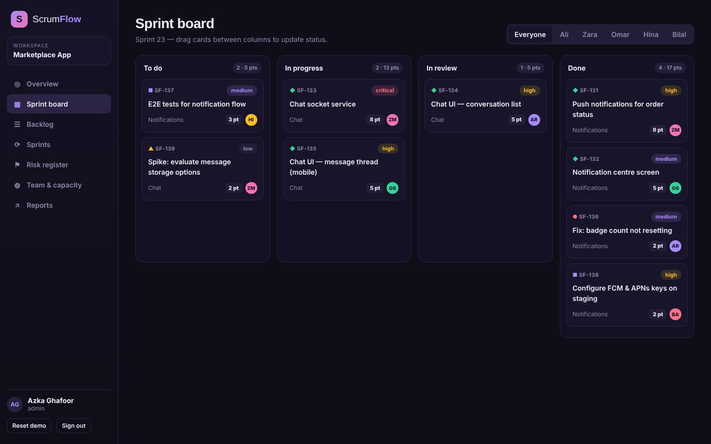
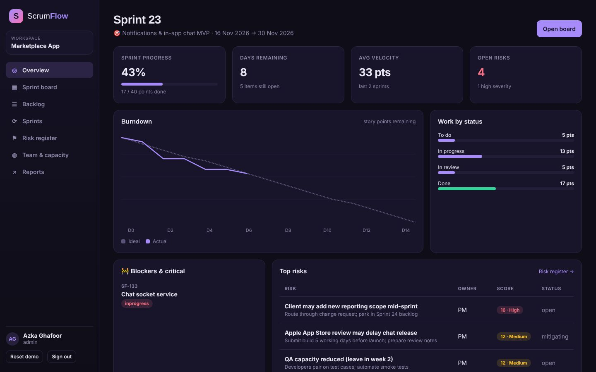
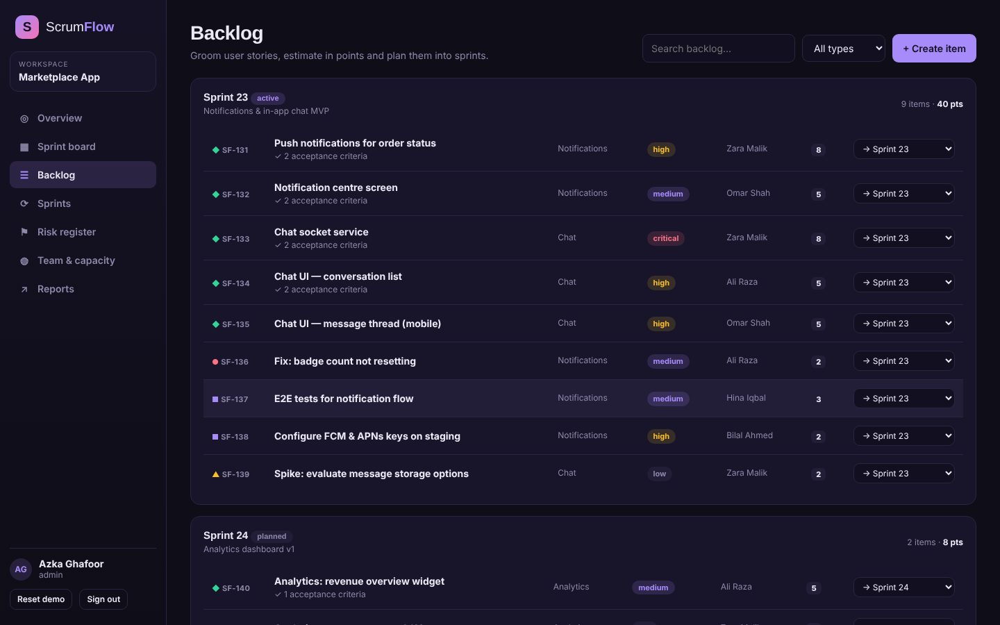
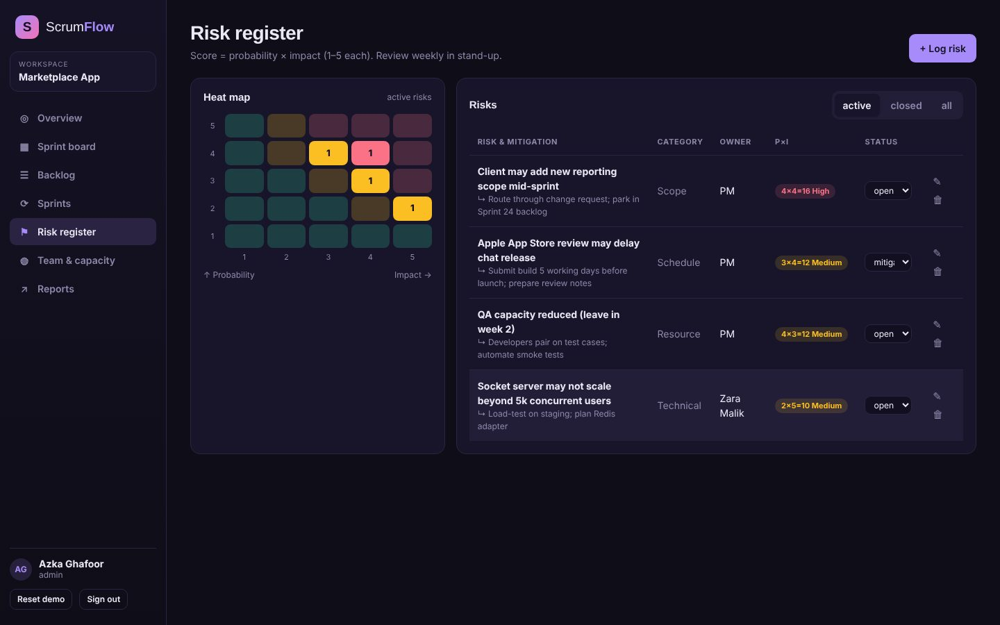
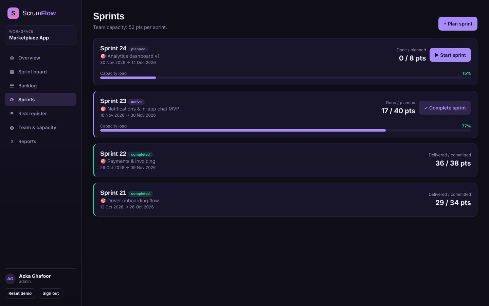
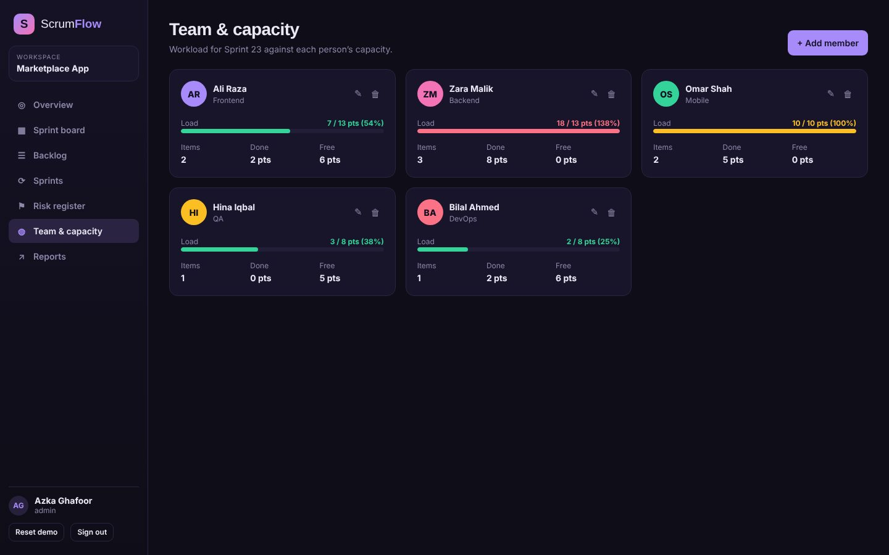
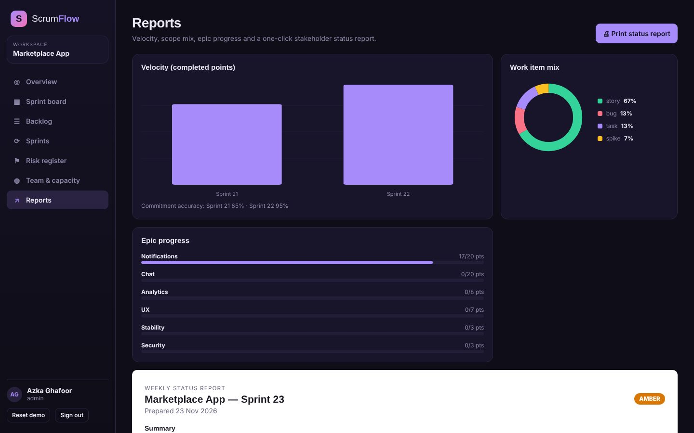

<div align="center">

# 🟪 ScrumFlow — Agile Project Management

**Backlog, sprint board, burndown, capacity, risk register and stakeholder status reports — one tool for the whole delivery cycle.**


**[🔗 Live demo](https://YOUR-USERNAME.github.io/scrumflow-agile-pm/)** · [Features](#-features) · [Screenshots](#-screenshots) · [Run locally](#-getting-started)



</div>

---

## 📌 Why I built this

As a project manager running Scrum across frontend, backend and mobile developers, I kept jumping between a ticket tracker, a spreadsheet risk register and a slide deck for weekly status. **ScrumFlow** brings those together and encodes the practices I actually use: user stories with acceptance criteria, capacity-aware sprint planning, P×I risk scoring and a RAG status report generated from live data.

## ✨ Features

| Page | What it does |
|---|---|
| **Overview** | Active sprint goal, progress %, days left, average velocity, burndown (ideal vs actual), blockers, top risks |
| **Sprint board** | Kanban (To do → In progress → In review → Done) with **drag-and-drop**, per-person filter, story points per column |
| **Backlog** | Stories / bugs / tasks / spikes grouped by sprint, priority ordering, epics, **acceptance criteria editor**, move items between sprints |
| **Sprints** | Plan, start and complete sprints; **capacity load %** warns when the team is over-committed; unfinished work rolls back to the backlog |
| **Risk register** | Probability × impact scoring, **5×5 heat map**, owner, mitigation plan, status workflow |
| **Team & capacity** | Points assigned vs capacity per person, done / free points |
| **Reports** | Velocity chart & commitment accuracy, work-item mix, epic progress, and a **printable weekly status report with automatic RAG rating** |

### Business rules implemented

- Only **one active sprint** at a time (enforced in the API).
- Starting a sprint snapshots **committed points**; completing it records **completed points** for velocity.
- Unfinished stories **return to the product backlog** when a sprint closes.
- RAG status = progress vs time elapsed in the sprint, downgraded if any high-severity risk is open.
- Story keys (`SF-123`) are auto-generated; `doneAt` is stamped when a story hits Done (drives the burndown).

## 📸 Screenshots

| Overview & burndown | Backlog |
|---|---|
|  |  |
| **Risk register** | **Sprints & capacity** |
|  |  |
| **Team** | **Status report** |
|  |  |

## 🧱 Tech stack

**Frontend:** React 18, React Router 6, Vite, native HTML5 drag-and-drop, SVG charts, custom dark theme
**Backend:** Node.js, Express 4, Mongoose 8, JWT auth with roles (`admin`, `manager`, `member`), Helmet
**Database:** MongoDB

## 🚀 Getting started

```bash
# API
cd server && cp .env.example .env && npm install
npm run seed        # pm@scrumflow.app / admin123
npm run dev         # http://localhost:5000

# Frontend
cd client && cp .env.example .env && npm install
npm run dev         # http://localhost:5173
```

> No MongoDB? Run only the client without a `.env` — it starts in **demo mode** with a realistic seeded sprint.

## 🔌 API overview

| Method | Endpoint | Notes |
|---|---|---|
| `POST` | `/api/auth/login` | Returns JWT |
| `GET/POST/PUT/DELETE` | `/api/stories` | Search with `?q=`, filter `?status=&sprint=` |
| `GET/POST/PUT/DELETE` | `/api/sprints` | *(manager+ to write)* |
| `POST` | `/api/sprints/:id/start` | Fails with `409` if another sprint is active |
| `POST` | `/api/sprints/:id/complete` | Records velocity, returns unfinished stories to backlog |
| `GET` | `/api/reports/velocity` | Committed vs completed per sprint |
| `GET/POST/PUT/DELETE` | `/api/risks`, `/api/members` | Risk register, team |

## 🗂 Structure

```
client/src/pages      Dashboard · Board · Backlog · Sprints · Risks · Team · Reports · Login
client/src/lib        agile.js (burndown, sprint rules, risk scoring) · api.js (API + demo mode)
server/src/models     Story · Sprint · Risk · Member · User
server/src/routes     crud factory · sprint start/complete · velocity
```

## 🛣 Roadmap

- Gantt / roadmap view across epics
- Comments and activity log per story
- Slack notifications when a story is blocked
- Export status report to PDF

## 👩‍💻 Author

**Azka Abdul Ghafoor** — Technical Project Manager · 📧 aazka4473@gmail.com

<sub>MIT licensed.</sub>
